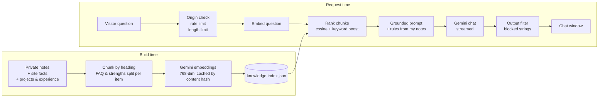

<div align="center">


# Harshit Ravi — Portfolio

**A pixel-art portfolio with a RAG chatbot that answers questions about me.**

[](https://github.com/Zeenith24/harshit-ravi-portfolio/actions/workflows/ci.yml)


</div>

I'm an AI & ML engineer who also designs, analyses data and does marketing, so this site shows all four. It is built like a retro desktop: every card is a pixel "window", and the whole thing is a bento grid in light and dark themes.

The part I'm proudest of is **Pokko**, the black cat in the corner. Ask Pokko anything about me (projects, internships, skills, goals) and it answers from my own notes, not from guesses.

## Highlights

- **Pokko, a retrieval-augmented chatbot** over my notes, projects and experience, with guardrails (see [How Pokko works](#how-pokko-works)).
- **Bento project grid** with category filters (ML / Design / Data / Marketing). The layout re-flows when you filter.
- **Content in Markdown.** A project or a job is one `.md` file; no layout code to touch.
- **Fast by design.** The original single-file version was 3.4 MB (inline base64 video, fonts and resume). The page is now about 25 KB of HTML, with the video, fonts and PDF as separate cached files.
- **Hand-built pixel art.** Sprites are drawn in code (`public/js/sprites.js`). Pokko's sprite was cleaned up from an AI-generated image and snapped to a true pixel grid, with a blink frame.
- **Accessible.** Skip link, labelled controls, keyboard support (`Esc` closes the chat), live-region announcements, and `prefers-reduced-motion` respected.

## How Pokko works



**Retrieval.** At build time `scripts/build-index.mjs` splits my notes by heading (FAQ answers and strengths are indexed one item at a time, because mixed chunks blur the embedding), embeds them with `gemini-embedding-001`, and saves a small JSON index. Unchanged chunks are not re-embedded. At request time the question is embedded, chunks are ranked by cosine similarity plus a small keyword boost (so "did he win anything?" finds "won 2nd place"), and the top 8 go into the prompt.

**Guardrails.**
- Answers only from the retrieved context. If it isn't there, Pokko says so and points to my email instead of guessing.
- Talks about me in the third person, never pretends to be me, and refuses off-topic requests and prompt-injection attempts.
- Never confirms contact details a visitor supplies.
- Addresses I marked off-limits are blocked in code. A streaming output filter catches them even when split across chunks, so it doesn't rely on the model behaving.
- Same-origin check, per-IP rate limit, a daily cap, and length limits. The API key is server-only (`astro:env`, never sent to the browser).

**Testing.** `scripts/test-pokko.mjs` is a regression harness that asks Pokko questions with no server needed and checks the answers: facts that must appear, things it must decline, and forbidden strings that must never appear. It also runs multi-turn conversations. My personal question set stays private; the public set covers prompt injection, off-topic questions and made-up facts.

```bash
npm run test:pokko                 # runs against the Gemini API, ~5 min on the free tier
POKKO_PUBLIC_ONLY=1 npm run test:pokko   # generic questions only
```

## Tech stack

| Area | Choice |
|---|---|
| Site | [Astro 7](https://astro.build) static pages + Markdown content collections |
| Chat endpoint | One server route (`src/pages/api/chat.ts`) via `@astrojs/vercel` |
| Embeddings / chat | Gemini `gemini-embedding-001` / `gemini-flash-lite-latest` |
| Frontend | Vanilla JS, hand-written CSS, pixel fonts (Pixelify Sans, Silkscreen) |
| Hosting | Vercel |

## Project structure

```
├── src/
│   ├── content/projects/      one .md file per project
│   ├── content/experience/    one .md file per job or internship
│   ├── components/            ProjectCard, WinBar, Pokko
│   ├── pages/index.astro      the page
│   ├── pages/api/chat.ts      Pokko's endpoint
│   └── lib/pokko-core.js      retrieval, prompt, streaming, output filter
├── scripts/
│   ├── build-index.mjs        notes -> chunks -> embeddings -> index
│   └── test-pokko.mjs         regression harness
├── knowledge/                 site facts + a blank notes template
└── public/                    sprites, fonts, video, resume, widget JS
```

## Run it locally

Requires Node 22.12 or newer.

```bash
npm install
cp .env.example .env      # then add your free key from https://aistudio.google.com/
npm run dev               # http://localhost:4321
```

Without a key the site works normally, and Pokko replies that it is not set up yet. To give Pokko your own knowledge, copy `knowledge/Harshit_deets.example.md` to `knowledge/Harshit_deets.md` and fill it in (that file is git-ignored).

## Add a project or a job

Drop a file in `src/content/projects/` (or `experience/`). The fields are checked at build time, so a typo fails with a clear message.

```markdown
---
title: My Project
window: my_project.py        # text in the pixel window's title bar
sprite: chart                # a sprite from public/js/sprites.js
spriteLabel: Pixel bar chart # alt text
category: data               # ml | design | data | marketing
hot: 95% accuracy            # the highlighted tag
tags: [Python, Pandas]
github: https://github.com/you/repo
order: 9
---
One or two sentences about what it does and the result.
```

## Deploy to Vercel

1. Import the repo into Vercel (framework: Astro; no other settings needed).
2. Add `GEMINI_API_KEY` under *Settings → Environment Variables*.
3. To give Pokko your private notes without committing them, add them as an environment variable. Vercel's value box may flatten line breaks, so encode the file as one line and use the name `KNOWLEDGE_DEETS_B64`:
   ```bash
   base64 -w0 knowledge/Harshit_deets.md   # paste the output as the value
   ```
   (Pasting the raw text into `KNOWLEDGE_DEETS` also works if your field keeps line breaks.)
4. In Google AI Studio, set a quota or budget on the key. The in-memory rate limit resets when the function restarts, so it is a first line of defence, not a guarantee.

Every push redeploys, and the index is rebuilt from the latest notes and content.

## License

The code is released under the [MIT License](LICENSE). The content is not covered by it: my bio, resume, projects text, notes, and the Pokko artwork are © Harshit Ravi, all rights reserved.

---

<div align="center">

Built by [Harshit Ravi](https://www.linkedin.com/in/harshitravi24/) · [GitHub](https://github.com/Zeenith24)

</div>
